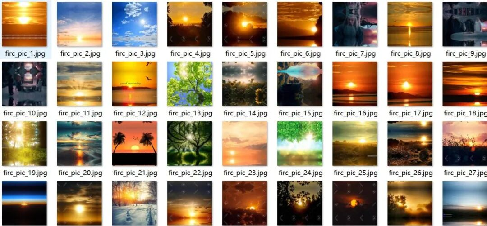
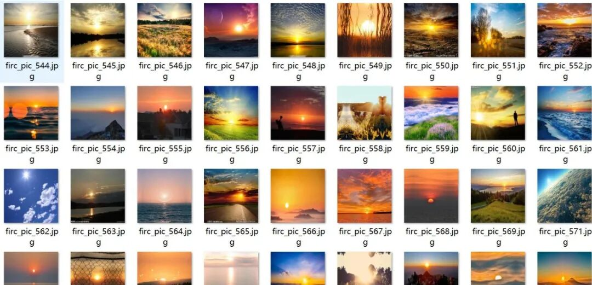
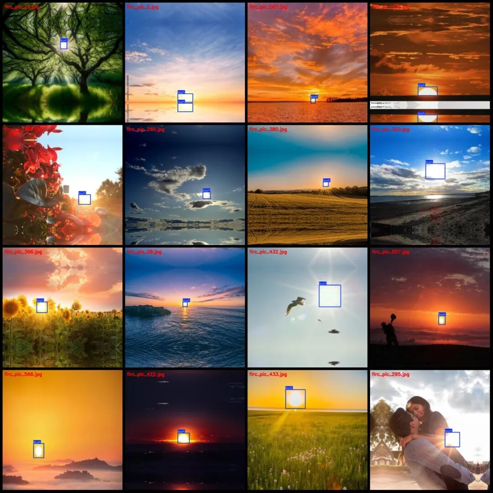
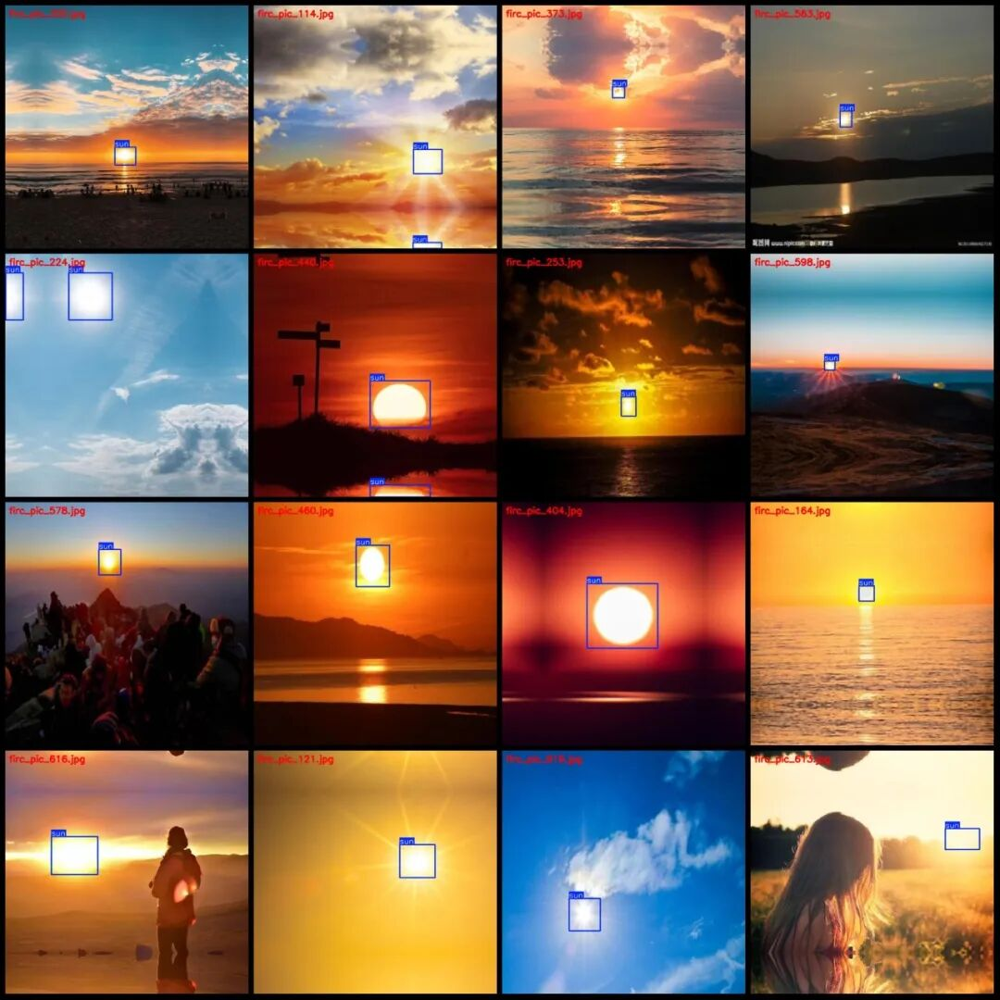

# VOC+YOLO format with 652 images in one category

Dataset format: Pascal VOC format + YOLO format (txt file without split path, only containing jpg images and corresponding VOC format xml files and yolo format txt files)

Number of images (number of jpg files): 652

Number of annotations (number of xml files): 652

Number of annotations (number of txt files): 652

Label category count: 1

Label category name: ["sun"]

Number of boxes labeled in each category:

Sun Frame Count = 808

Total frame count: 808

Number of images per category:

Sun's ownership count = 652

Image resolution: 640x640

Using labelImg:

Annotation rules: Draw a rectangle around the category.

Important Notice: The dataset does not have separate training, validation, and test sets; you need to partition them yourself.

Special : This dataset does not guarantee the accuracy of the trained models or weight files.

Image Preview:

Annotation example:

## Payment

Here is a pay link on Stripe ( https://buy.stripe.com/3cs8yP7sY87d0vu9AB ). Please contact me lonlonago@foxmail.com after funding $89, and I will send you a complete data files , thank you!

